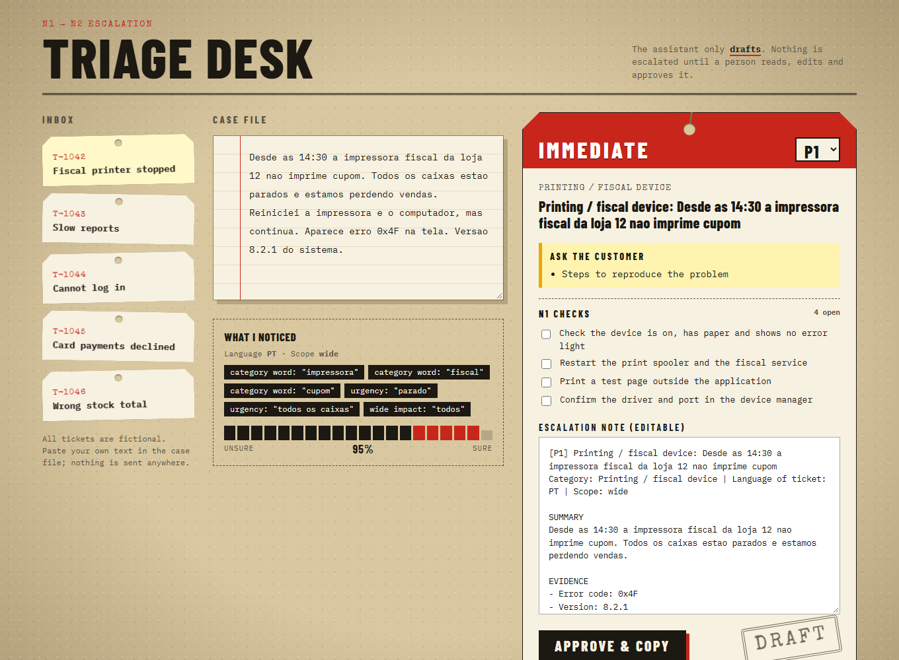

# Triage Desk

A human-in-the-loop assistant that turns a raw support ticket into a **draft N2 escalation note**. It reads the ticket, notices what matters, asks for what is missing, and then waits for a person to read, edit and approve. Nothing is escalated without that approval.



## The problem
When a Tier 1 analyst escalates a ticket with a vague summary and no reproduction steps, Tier 2 loses time asking the same questions again. I did this job in ERP/POS support, and the best escalations always had the same ingredients: clear impact, hard evidence, what was already tried, and what is still unknown.

## What it does
1. **Reads** a ticket in English, Spanish or Portuguese and detects the language.
2. **Classifies** it (printing, database, performance, network, access, payment, reports, update, or general).
3. **Prioritises** it with a triage tag: red (P1, immediate), yellow (P2, urgent), green (P3, routine). It looks at urgency words and at how many people are affected.
4. **Extracts evidence:** error codes, HTTP statuses, versions, store numbers, times, and what the customer already tried.
5. **Asks for what is missing** (error message, version, when it started, steps, scope).
6. **Suggests N1 checks** to do before escalating, as a checklist.
7. **Drafts the escalation note**, fully editable.
8. **Waits for approval.** The stamp says DRAFT until a person clicks "Approve & copy".
9. **Explains itself:** "What I noticed" lists the exact signals behind the draft, plus a confidence gauge.

## Design idea
Triage is a medical word, so the interface is a **triage desk**: tickets hang as paper tags, the case file is lined paper, the verdict is a colour-coded triage tag with a string, the note looks like a thermal-printer strip, and approval is a rubber stamp. The goal was an interface that nobody would mistake for another dashboard template, while keeping every control easy to read and use.

## Decisions
| Decision | Reason |
|---|---|
| The assistant drafts, a person approves | Wrong escalations cost time. The stamp, the editable note and the open-checks counter keep the analyst in charge |
| Rules engine, not an AI model | Free, instant, explainable, and the demo needs no API key. Every draft shows the words that caused it |
| `Provider` interface (`src/ai/provider.ts`) | A real language model can replace the local engine without touching the UI or the approval step |
| Everything runs in the browser | No server, no data leaves the page. Safe to demo with any pasted text |
| Fictional tickets only | No real customer data anywhere |
| History saved in `localStorage`, with a safe fallback | Works even where storage is blocked |

## Run it
```bash
npm install
npm run dev        # http://localhost:5173
npm test           # 14 unit tests
npm run build
```

## Tests
14 tests cover text normalisation, language detection, evidence extraction, "already tried" detection, priority and scope rules, missing-information questions, the fallback category, note structure and confidence limits.

## Project layout
```
src/
  engine/     rules.ts (dictionaries), triage.ts (the engine), samples.ts, types.ts, tests
  ai/         provider.ts (Provider interface + local provider)
  ui/         Gauge, history storage
  App.tsx     the desk
  styles.css  the visual identity
```

## Known limits
- Keyword rules miss unusual wording and cannot understand a ticket the way a language model can.
- The draft note is in English (the usual language of an N2 queue), whatever the ticket language is.
- Categories and words are tuned for ERP/POS support and need new dictionaries for other domains.
- No accounts, no sharing, no real ticketing integration yet.

## Roadmap
- [ ] Optional language-model provider behind a small proxy, with a spending cap and caching
- [ ] Export to common ticketing tools
- [ ] Per-team dictionaries and custom checklists
- [ ] Keyboard shortcuts for faster approval
- [ ] Measure how often analysts edit the draft, to improve the rules

## Author
Rhuan Kheviny · [LinkedIn](https://www.linkedin.com/in/rhuan-kheviny-0a5450179)

## License
MIT
